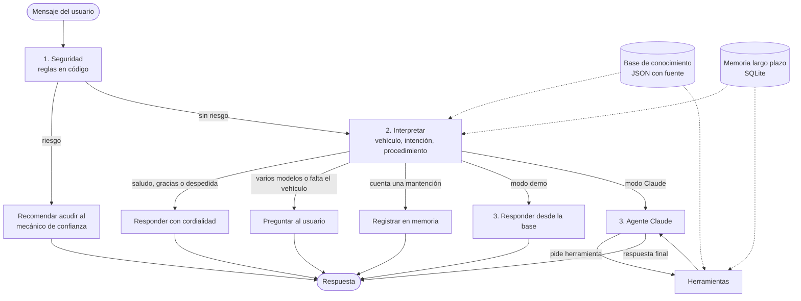

# MecaIA

Agente de IA que ayuda a personas dueñas de un auto o una moto con la mantención de su vehículo.
Ante una pregunta como "¿qué aceite necesito para mi Kawasaki 400?", MecaIA:

1. revisa si hay un riesgo de seguridad y, si lo hay, recomienda acudir a su mecánico de confianza,
2. confirma el modelo exacto del vehículo (pregunta si hay más de uno posible),
3. busca el dato en una base de conocimiento verificada, en vez de responder de memoria,
4. responde con el dato exacto, las herramientas, qué hacer si no las tienes, el paso a paso,
   recordatorios (por ejemplo, cambiar el filtro junto con el aceite) y cuándo acudir a su mecánico de confianza,
5. responde dudas frecuentes: cada cuánto se hace cada mantención y cuánto demora (bujías, balatas,
   filtro de aire, correa de distribución, etc.) y cuánto rinde el estanque de cada auto o moto,
6. recuerda los vehículos y las mantenciones del usuario para las próximas consultas,
7. conversa con cordialidad: responde saludos y agradecimientos, y siempre ofrece seguir ayudando.

Proyecto de la asignatura Ingeniería de Soluciones con Inteligencia Artificial (Evaluación Parcial 2).

## Cómo ejecutarlo

Guía paso a paso para Windows y Visual Studio Code: [docs/como_ejecutar.md](docs/como_ejecutar.md).
Diagramas y decisiones de diseño: [docs/diseno.md](docs/diseno.md).

Resumen (requiere Python 3.10 o superior):

```bash
pip install -r requirements.txt

# Modo demo: no necesita API key ni tiene costo
python main.py --demo --ver-plan

# Modo Claude: el modelo de lenguaje interpreta preguntas libres y decide qué herramientas usar
export ANTHROPIC_API_KEY=tu_api_key        # en Windows: set ANTHROPIC_API_KEY=tu_api_key
python main.py --usuario ana --ver-plan

# Pruebas automáticas
python -m pytest -v

# Regenerar la conversación de evidencia
python scripts/generar_evidencias.py

# Imprimir el grafo del agente en formato Mermaid
python main.py --demo --grafo
```

Opciones de `main.py`:

| Opción | Para qué sirve |
| --- | --- |
| `--demo` | Fuerza el modo sin modelo de lenguaje (sin costo) |
| `--usuario` | Nombre del usuario; su memoria de largo plazo se guarda con ese nombre |
| `--conversacion` | Identificador de la conversación (memoria de corto plazo) |
| `--ver-plan` | Muestra las decisiones que tomó el agente en cada turno |
| `--grafo` | Imprime el diagrama del grafo y termina |

Si no hay `ANTHROPIC_API_KEY` definida, `main.py` usa el modo demo automáticamente. El modelo se
cambia con la variable `MECAIA_MODELO` (por defecto `claude-opus-5-5`).

## Cómo cumple la pauta

| Requisito de la evaluación | Dónde está |
| --- | --- |
| Framework de agentes | LangGraph (`mecaia/grafo.py`), con `ChatAnthropic` de LangChain como modelo |
| Herramientas de consulta | `buscar_vehiculo`, `obtener_datos_vehiculo`, `buscar_procedimiento`, `consultar_mantenimiento_periodico`, `mis_vehiculos`, `revisar_seguridad` |
| Herramientas de escritura | `guardar_vehiculo`, `registrar_mantencion` (escriben en la memoria de largo plazo) |
| Razonamiento | Nodo `agente`: Claude decide qué herramienta usar y redacta la respuesta con los datos obtenidos |
| Memoria de corto plazo | Checkpointer de LangGraph (`SqliteSaver`): guarda mensajes, vehículo confirmado y preguntas pendientes de cada conversación |
| Memoria de largo plazo | `mecaia/memoria.py` (SQLite): vehículos y mantenciones de cada usuario entre conversaciones |
| Planificación | El grafo ordena las etapas: seguridad → interpretar → aclarar, registrar o responder. Cada turno deja su plan en `estado["plan"]` (`--ver-plan`) |
| Decisiones adaptativas | Aristas condicionales: recomienda acudir al mecánico de confianza si hay riesgo, responde con cordialidad a saludos y agradecimientos, pregunta si el modelo es ambiguo o falta, registra si el usuario cuenta una mantención, usa la memoria si no menciona el vehículo |
| Evidencias de pruebas | `tests/` (59 pruebas), `evidencias/resultado_pruebas.txt`, `evidencias/conversacion_demo.md` |

## Arquitectura



El chequeo de seguridad corre en código antes que el modelo de lenguaje: una pregunta riesgosa
("mi moto no frena") nunca recibe instrucciones de reparación, aunque el modelo se equivoque.

## Estructura del repositorio

| Ruta | Contenido |
| --- | --- |
| `main.py` | Chat en la terminal |
| `mecaia/grafo.py` | Grafo de LangGraph: estado, nodos, rutas y herramientas del modelo |
| `mecaia/herramientas.py` | Lógica de cada herramienta |
| `mecaia/seguridad.py` | Detección de riesgos con reglas |
| `mecaia/base_conocimiento.py` | Búsqueda de vehículos y procedimientos |
| `mecaia/memoria.py` | Memoria de largo plazo (SQLite) |
| `mecaia/respuestas.py` | Textos de respuesta del modo demo |
| `mecaia/conocimiento/` | Base de conocimiento: 16 vehículos, 3 procedimientos y reglas de seguridad |
| `docs/` | Diseño (diagramas, flujos, memoria) y guía de ejecución |
| `tests/` | Pruebas automáticas (59) |
| `evidencias/` | Resultados de pruebas y conversación de ejemplo |
| `scripts/generar_evidencias.py` | Genera la conversación de ejemplo |

## Base de conocimiento

Vehículos cargados:

- **Autos:** Hyundai Accent 1.4, Hyundai Elantra 1.6, Suzuki Swift 1.2, Suzuki Alto 800, Toyota Yaris 1.5.
- **Motos:** Kawasaki Ninja 400, Z400 y KZ400, Suzuki Gixxer 150, KTM RC 200, Yamaha MT-03, YZF-R3 y
  YZF-R15 V3, Honda CBR250R, CBR300R y CB190R.

Procedimientos: cambio de aceite, revisión de pastillas de freno y presión de neumáticos.

Mantención periódica (`mantenimiento_periodico.json`): cada cuánto se hace y cuánto demora el cambio
de aceite, filtro de aire, bujías, pastillas de freno (balatas), líquido de frenos, refrigerante,
correa de distribución, neumáticos, cadena y kit de arrastre, y batería, para autos y motos.

Cada vehículo incluye además la capacidad del estanque y un rendimiento aproximado, con los que
el agente estima la autonomía.

Cada dato técnico lleva `fuente` y `verificado`. Los valores actuales son de referencia y están
marcados `verificado: false` hasta contrastarlos con el manual oficial de cada vehículo. Cuando un
dato no existe (`null`), el agente lo dice en vez de inventarlo. Para agregar un vehículo basta con
crear un archivo JSON en `mecaia/conocimiento/vehiculos/` con la misma estructura.

## Limitaciones conocidas

- El modo demo reconoce intenciones con palabras clave; el modo Claude entiende preguntas libres.
- Los datos técnicos aún no están verificados contra manuales oficiales.
- La detección de riesgos usa reglas fijas y puede no reconocer descripciones poco comunes.
