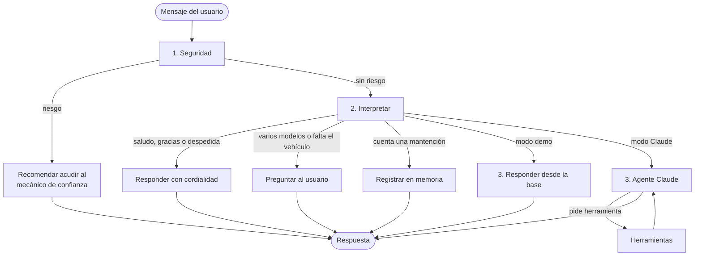
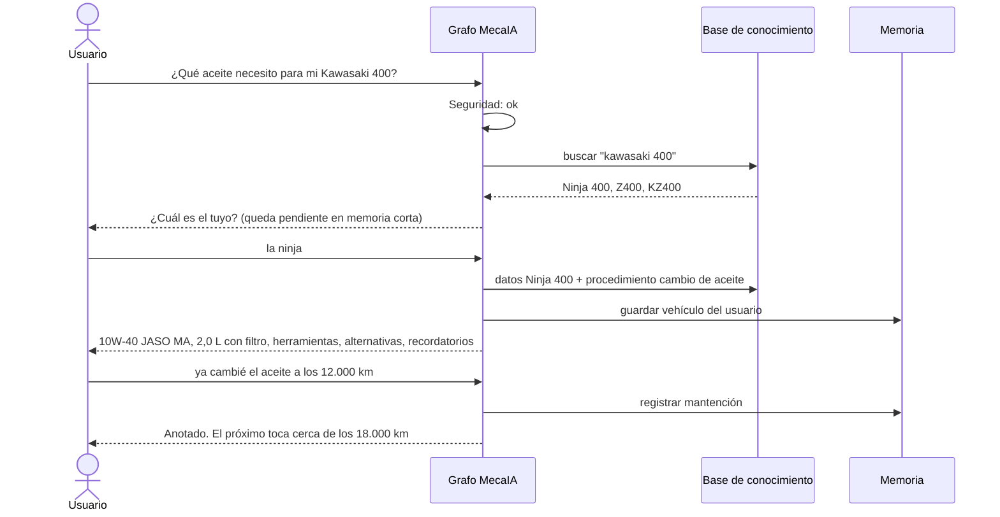
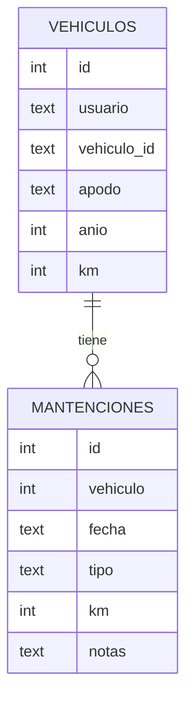

# Diseño de MecaIA

Bocetos y flujos de trabajo del agente. Los diagramas usan Mermaid y GitHub los muestra como
imágenes.

## 1. Problema y usuario

Una persona dueña de un auto o una moto quiere saber qué necesita para una mantención básica (qué
aceite, qué herramientas, qué hacer si no las tiene) sin arriesgarse a seguir datos incorrectos de
internet. MecaIA responde con datos de una base verificada, avisa cuando algo es peligroso y recomienda
acudir al mecánico de confianza cuando el caso excede lo que se puede hacer en casa. También
responde dudas frecuentes (cada cuánto se hace una mantención, cuánto rinde el estanque) y conversa
con cordialidad.

## 2. Flujo del agente (grafo de LangGraph)

| Nodo | Qué decide |
| --- | --- |
| Seguridad | Reglas en código detectan frenos que fallan, olor a combustible, humo, sobrecalentamiento, etc. Si hay riesgo, el flujo termina recomendando acudir al mecánico de confianza, sin pasar por el modelo |
| Interpretar | Identifica vehículo, intención (consulta de un procedimiento, intervalo de mantención, estanque, registro o conversación) y procedimiento. Busca el vehículo en este orden: el mensaje, la respuesta a una pregunta anterior, la memoria de la conversación, la memoria de largo plazo |
| Conversar | Responde saludos, agradecimientos y despedidas con calidez y ofrece seguir ayudando |
| Aclarar | Pregunta cuando hay más de un modelo posible (ej. "Kawasaki 400") o falta el vehículo, y deja la pregunta pendiente en el estado |
| Registrar | Escribe la mantención en la memoria de largo plazo y calcula cuándo toca la próxima |
| Responder / Agente | Arma la respuesta con los datos de la base. En modo Claude, el modelo decide qué herramientas llamar |

## 3. Ejemplo de conversación

## 4. Memoria

| Tipo | Implementación | Qué guarda | Duración |
| --- | --- | --- | --- |
| Corto plazo | Checkpointer de LangGraph (`SqliteSaver`) | Mensajes, vehículo confirmado, pregunta pendiente | Una conversación (`thread_id`) |
| Largo plazo | SQLite propio (`mecaia/memoria.py`) | Vehículos y mantenciones de cada usuario | Entre conversaciones |

## 5. Base de conocimiento

Archivos JSON en `mecaia/conocimiento/`:

- `vehiculos/`: un archivo por modelo con aceite, capacidades, filtro, torques, medidas, estanque y rendimiento. Cada grupo
  de datos tiene `fuente` y `verificado`.
- `procedimientos/`: pasos, herramientas, alternativas sin herramientas, recordatorios,
  advertencias y señales para acudir al mecánico de confianza.
- `mantenimiento_periodico.json`: cada cuánto se hace cada mantención y cuánto demora, para autos y motos.
- `seguridad.json`: patrones de riesgo en dos niveles, `detener` y `precaucion`.

## 6. Decisiones de diseño

- **Datos solo desde la base.** El modelo de lenguaje no inventa viscosidades ni capacidades; si un
  dato falta, lo dice. Así se reducen los errores, que en mecánica pueden dañar un motor.
- **Seguridad en código.** El chequeo de riesgo no depende de que el modelo lo recuerde.
- **Confirmar antes de responder.** "Kawasaki 400" puede ser tres motos distintas con aceites
  distintos, por eso el agente pregunta.
- **Modo demo.** El mismo grafo funciona sin modelo de lenguaje, para probar y presentar sin costo.
